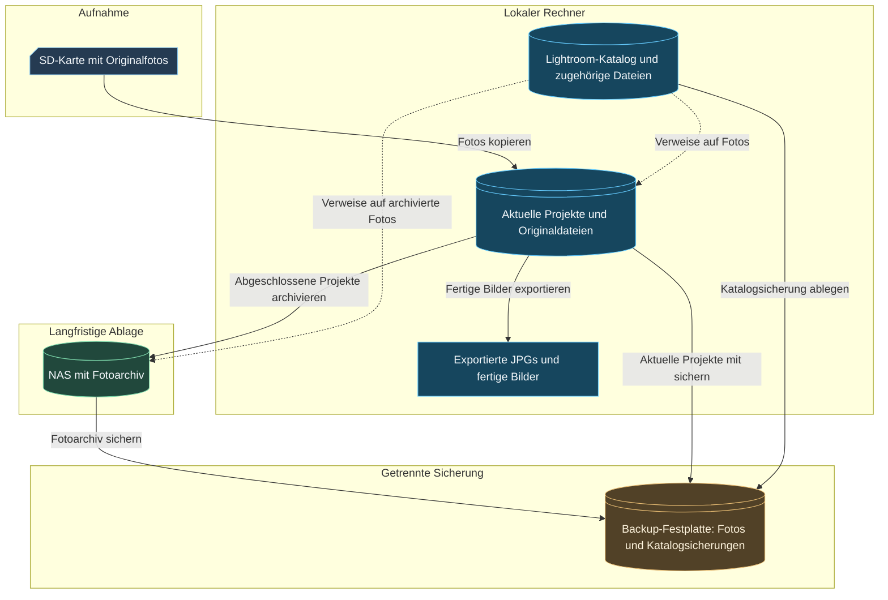
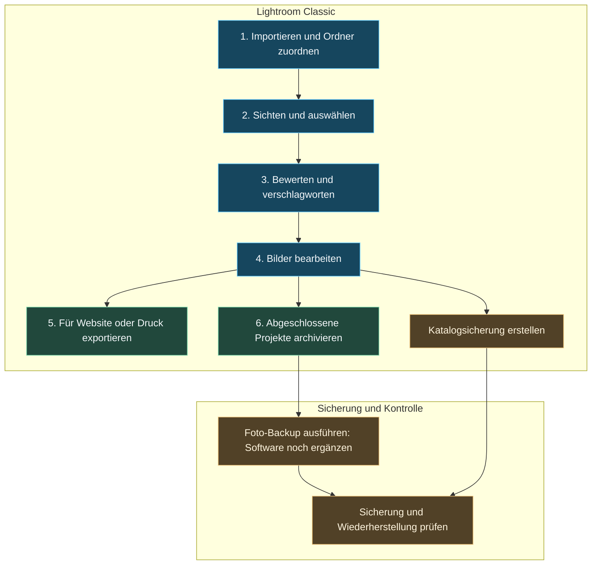
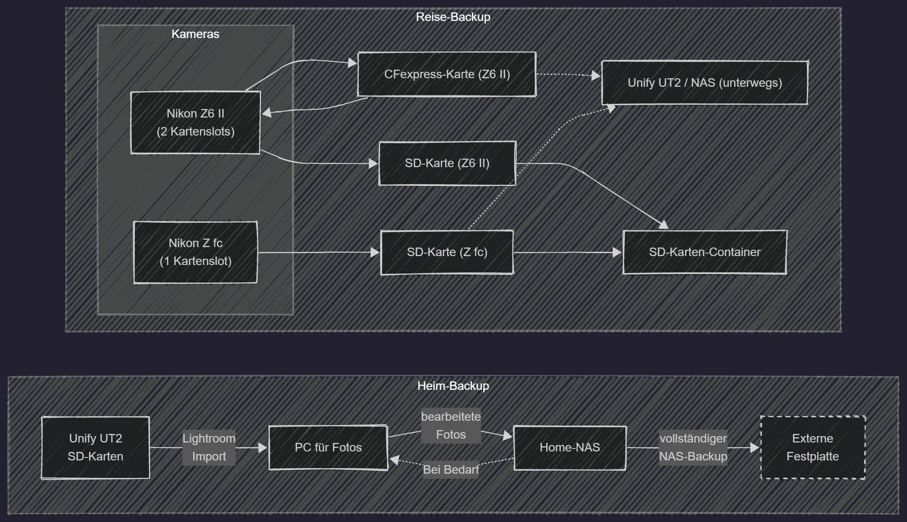

## Was ich speichere und warum

## Meine Speicherorte

Für die Übersicht trenne ich die Speicherstruktur von der Software. Hier geht es zuerst darum, wo Originaldateien, Lightroom-Kataloge und Sicherungskopien liegen. Der Ablauf in den Programmen folgt in einem eigenen Diagramm weiter unten.



Durchgezogene Pfeile beschreiben Dateivorgänge. Gestrichelte Pfeile zeigen die Verknüpfung des Katalogs mit den Fotos: Die Bilddateien liegen außerhalb des Katalogs.

### Aktuelle Projekte

Aktuelle Projekte und der aktive Lightroom-Classic-Katalog sind in dieser Vorlage auf dem lokalen Rechner eingezeichnet. Den genauen Laufwerks- und Ordnerpfad ergänze ich noch.

### Das Archiv

Das NAS bildet die langfristige Ablage für abgeschlossene Fotoprojekte. Die Backup-Festplatte enthält eine weitere Kopie der Fotos sowie die Katalogsicherungen.

### Lightroom-Katalog und Fotos gehören zusammen

Der Katalog enthält Verweise, Bewertungen und Bearbeitungsinformationen; die Originalfotos werden getrennt gespeichert. Beides muss im Sicherungskonzept berücksichtigt werden. Eine Lightroom-Katalogsicherung allein sichert die Fotos nicht mit. Das beschreibt Adobe in den [Kataloggrundlagen](https://helpx.adobe.com/uk/lightroom-classic/desktop/manage-catalogs-and-files/lightroom-catalog-basics.html) und der [Anleitung zur Katalogsicherung](https://helpx.adobe.com/in/lightroom-classic/desktop/manage-catalogs-and-files/back-catalog.html).

Der aktive Lightroom-Classic-Katalog bleibt lokal. Originalfotos können auf dem NAS liegen; einen aktiven Katalog auf einem Netzlaufwerk unterstützt Lightroom Classic laut [Adobe-Katalog-FAQ](https://helpx.adobe.com/in/lightroom-classic/desktop/technical-support/workflow-issues/catalog-issues/catalog-faq-lightroom.html) nicht.

## Software und Arbeitsschritte

Diese zweite Ansicht zeigt die Aufgaben in Lightroom Classic und beim Sichern. Die Speichergeräte aus der ersten Übersicht treten hier hinter den Arbeitsschritten zurück.



Das Diagramm ist eine grobe Übersicht, kein fester Sicherungszeitplan. Die konkrete Häufigkeit und das verwendete Backup-Programm ergänze ich noch. Ordner, deren Fotos bereits katalogisiert sind, verschiebe ich innerhalb von Lightroom Classic, damit die Verweise erhalten bleiben.

| Aufgabe | Software oder Funktion | Noch zu dokumentieren |
| :--- | :--- | :--- |
| Import | Lightroom Classic | Zielordner, Benennung und Importvorgaben |
| Auswahl und Organisation | Lightroom Classic | Bewertungen, Markierungen und Schlagwörter |
| Bearbeitung | Lightroom Classic | Grundschritte und verwendete Vorgaben |
| Export | Lightroom Classic | Bildgrößen, Dateiformate und Zielordner |
| Archivierung | Ordnerverwaltung in Lightroom Classic | Zeitpunkt und Zuordnung zum Fotoarchiv |
| Katalogsicherung | Sicherungsfunktion von Lightroom Classic | Sicherungsziel und Aufbewahrung |
| Foto-Backup | Programm noch ergänzen | Sicherungsumfang, Zeitplan und Versionierung |

### Vorhandene Skizze als Ausgangspunkt

{width=80% round=12px align=center}

Die vorhandene Skizze kombiniert Geräte und Arbeitsschritte. Die beiden neuen Diagramme teilen diese Informationen in eine Speicheransicht und eine Softwareansicht auf. Der Reiseteil mit den Kameras und dem Unify UT2 kann später im eigenen Artikel zur Sicherung unterwegs ausführlicher beschrieben werden.

## Ordnerstruktur und Dateinamen

Die folgende Struktur ist ein Vorschlag zum Ausfüllen, noch keine Bestandsaufnahme der tatsächlichen Ordner:

```text
Lokaler Rechner/
  Fotos/
    Aktuell/
      JJJJ-MM-TT_Projekt/
        Originale/
        Exporte/
  Lightroom/
    Katalog/
      Mein-Katalog.lrcat
      weitere zugehörige Katalogdateien
    Katalogsicherungen/

NAS/
  Fotoarchiv/
    JJJJ/
      JJJJ-MM-TT_Projekt/

Backup-Festplatte/
  Fotoarchiv-Backup/
  Aktuelle-Projekte-Backup/
  Lightroom-Katalogsicherungen/
```

## Meine Backup-Strategie

### Was wird wann gesichert?

### Getrennte Sicherungskopien

### Wiederherstellung prüfen

## Pflege und Aufräumen

## Meine Erfahrungen

