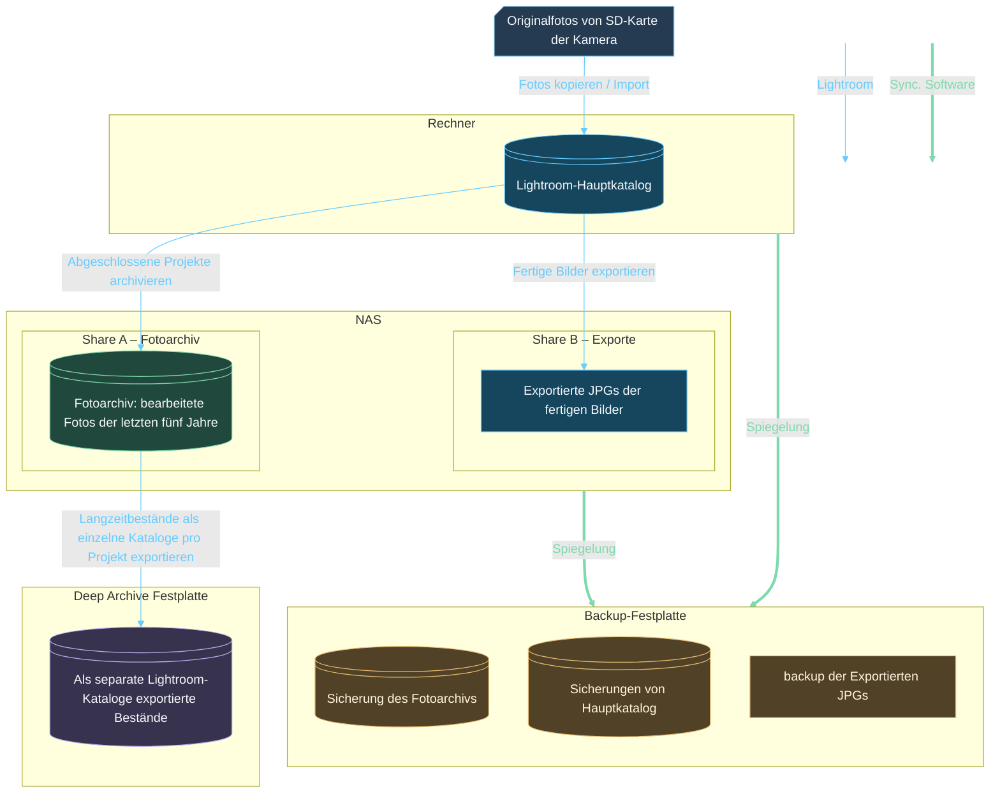

## Meine Speicherorte

Für das Foto-Backup zu Hause gehe ich ähnlich vor wie mit meinen anderen Daten – auch wenn ich meine Disziplin da noch etwas verbessern könnte. Auf meinem PC liegen die Fotos zur Bearbeitung auf einer separaten eingebauten M.2-SSD. Hier werden auch alle Fotos vom UT2 oder den SD-Karten per Lightroom-Import abgelegt. Die Fotos, die bereits bearbeitet wurden, verschiebe ich auf einen Home-NAS und kann sie von dort bei Bedarf wieder auf den PC holen, wenn ich noch einmal daran arbeiten möchte.
Der NAS wird regelmäßig komplett (mit allen anderen Daten) auf eine externe Festplatte gespiegelt. Diese Festplatte sollte am besten an einem anderen Ort gelagert werden (Offsite-Backup).

Das hier soll eine kurze Übersicht werden zu meiner Speicherstruktur der Fotos und wie ich PC, NAS und Festplatten mit Lightroom nutze, um meine Fotos zu organisieren. 
Das Ganze startet mit den Speicherkarten, die in Lightroom importiert werden. in Lightroom wird dann der Hauptkatalog genutzt, um fotos auf der PC festplatte und dem NAS zu verwalten. Alle Fotos die ich aktiv bearbeite, liegen auf dem PC lokal. Alle Fotos, die schon bearbeitet wurden, liegen auf dem NAS (das sind etwa die letzten 5 Jahre). Aus dem Hauptkatalog werden ungerschiedliche andere kataloge abgeleitet, die jeweils ein stück auf dem PC liegen, ein Stück auf dem NAS. Alle fotos, die "nie wieder" genutzt werden, werden auf eine Festplatte als separate Kataloge exportiert. Der lokale Hauptkatalog verwaltet Fotos auf dem Rechner und dem NAS. Daraus entstehen weitere Kataloge für das Deep Foto Archive enthält die als separate Kataloge exportierten Langzeitbestände mit ihren zugehörigen Originalfotos.

## Meine Erfahrungen
Mit diesem Aufbau stelle ich mich etwas gegen die [Kataloggrundlagen](https://helpx.adobe.com/uk/lightroom-classic/desktop/manage-catalogs-and-files/lightroom-catalog-basics.html) von Adobe, passe mich aber an die  [Anleitung zur Katalogsicherung](https://helpx.adobe.com/in/lightroom-classic/desktop/manage-catalogs-and-files/back-catalog.html)
an. Entgegen der Aussage der [Adobe-Katalog-FAQ](https://helpx.adobe.com/in/lightroom-classic/desktop/technical-support/workflow-issues/catalog-issues/catalog-faq-lightroom.html) läuft bei mir ein aktiver Katalog auf einem NAS share eins A.

