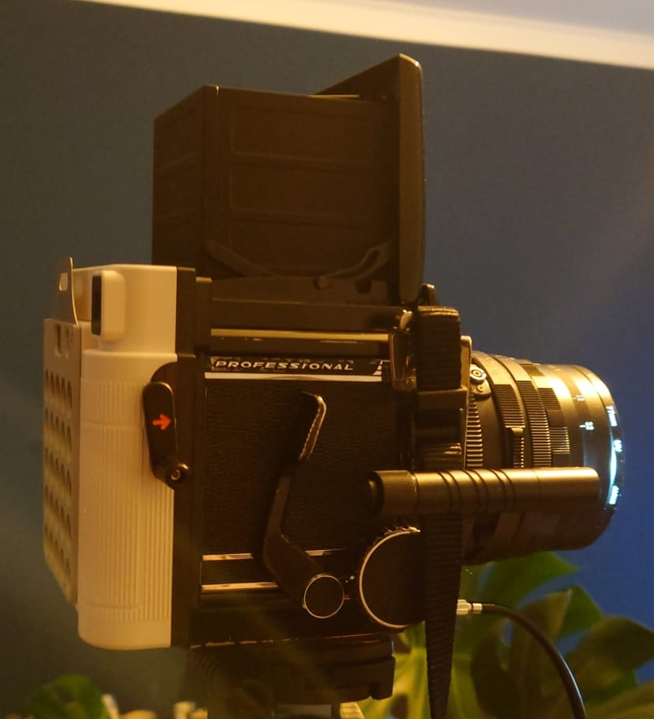

## Hallo aus dem Testblog

Dies ist **Testbeitrag 01**. Die Startkarte zeigt einen kurzen Titel und eine kompakte Vorschau.

{width=100% round=12px align=center}

### Der erste Eindruck

Hier beginnt die Sammlung verschiedener Testinhalte. Titelbild, Datum und Autorenzeile sollen auf einen Blick erkennbar sein.
