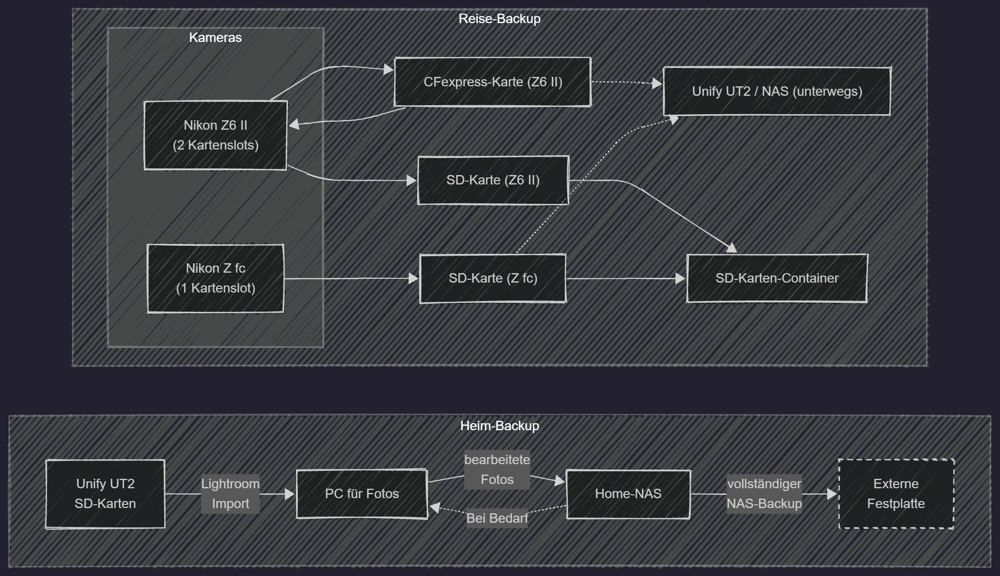

## Raum für Kreativität

Dies ist **Testbeitrag 04**. Dieser Artikel hat einen besonders langen Titel, um Zeilenumbrüche im Layout sichtbar zu machen.

{width=100% round=12px align=center}

### Kleine Veränderungen

Eine freie Arbeitsfläche, ein Notizbuch und etwas Tageslicht geben neuen Ideen Platz.

#### Ein Detail zum Schluss

Auch eine Überschrift der vierten Ebene gehört zu diesem Formatierungstest.
