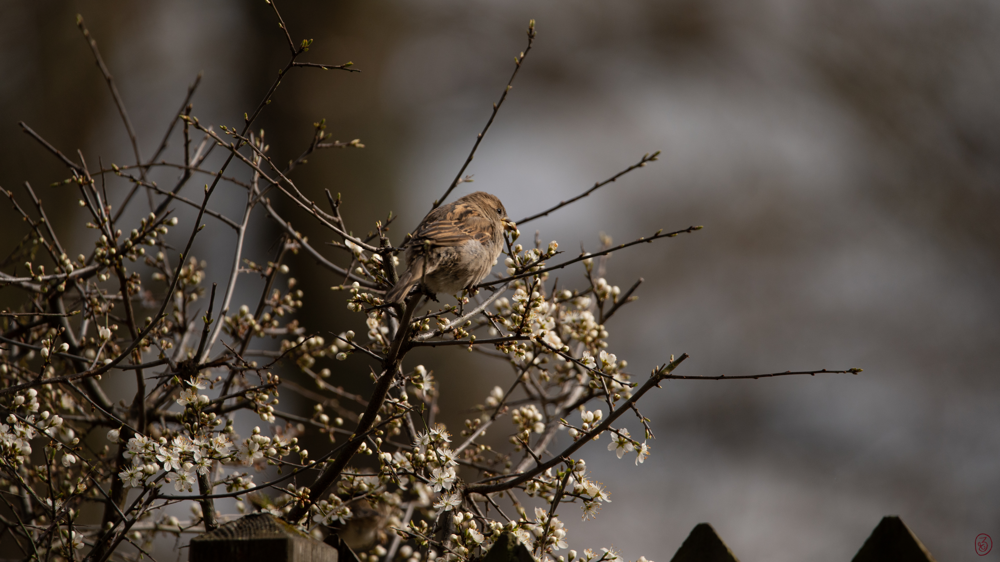

## Zwischen den Bäumen

Dies ist **Testbeitrag 05**. Ein grünes Waldmotiv begleitet diesen Spaziergang als Cover und als Bild im Artikel.

{width=80% round=12px align=center}

Das Licht fällt durch die Blätter.
Unter den Schuhen raschelt trockenes Laub.
Ein schmaler Weg führt tiefer in den Wald.

### Darauf achten

Cover, Artikelbild und kurze Textzeilen sollen zusammen gut lesbar bleiben.
