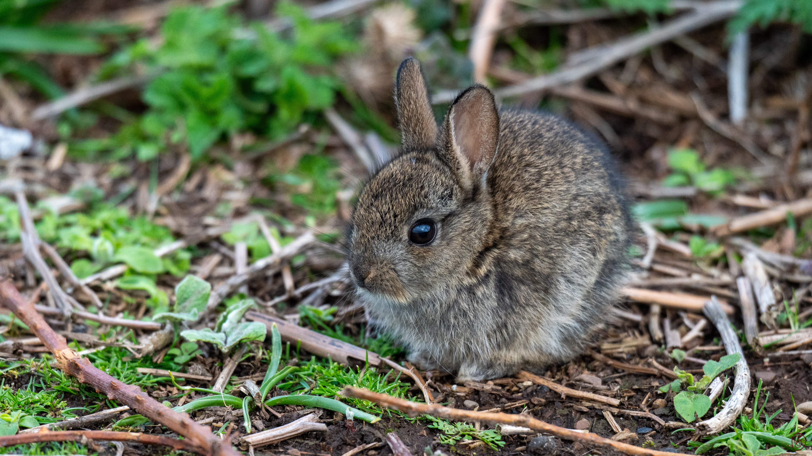

## Eine kleine Farbpalette

Dies ist **Testbeitrag 06**. Drei Farbtöne stehen heute im Mittelpunkt.

{width=60% round=12px align=center}

### Orange

Ein kräftiger Akzent für wichtige Stellen.

### Gold

Ein warmer Ton für kleine Highlights.

### Dunkles Grün

Eine ruhige Basis für das gesamte Farbbild.
