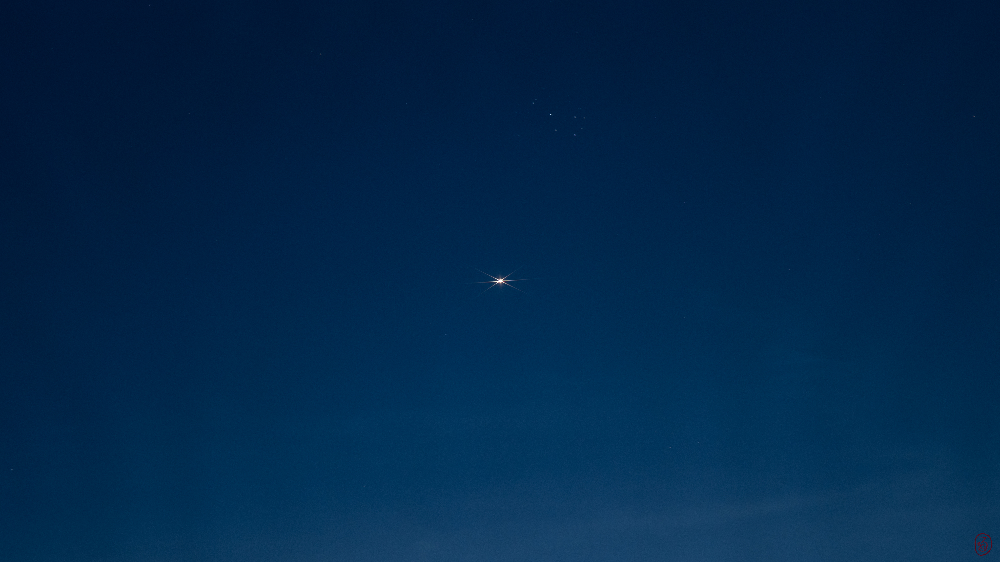

## Wenn die Stadt aufleuchtet

Dies ist **Testbeitrag 07**. Nach Sonnenuntergang verändert sich der Blick auf vertraute Straßen. Schaufenster spiegeln sich auf dem Asphalt, während die letzten Cafés ihre Stühle hineintragen.

{width=100% round=12px align=center}

### Ein Weg ohne festes Ziel

An der nächsten Kreuzung biegen wir spontan ab. Hinter einer schmalen Passage wartet ein stiller Innenhof. Für einen Moment klingt der Verkehr nur noch wie ein fernes Rauschen.

### Zurück auf dem Platz

Eine Straßenbahn zieht vorbei. Wir setzen uns auf eine Bank und beobachten, wie die Fenster der Häuser nach und nach hell werden.

### Ende des Rundgangs

Dieser längere Text macht die Darstellung mehrerer Abschnitte und die Abstände zwischen Überschriften sichtbar.
