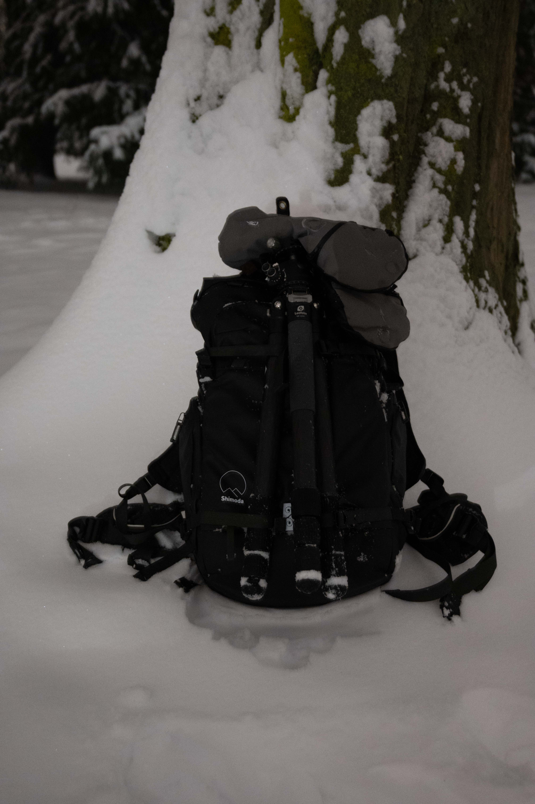

## Grüße aus dem Testarchiv

Dies ist **Testbeitrag 10**. Diese fiktive Postkarte bleibt anonym.

{width=100% round=12px align=center}

### Eine kleine Nachricht

Heute senden wir einen Gruß aus einer Landschaft, die nur für diesen Layouttest ausgewählt wurde.

### Ohne Absender

Autor, Autorenlink und Icon sind in den Metadaten ausdrücklich auf null gesetzt.
