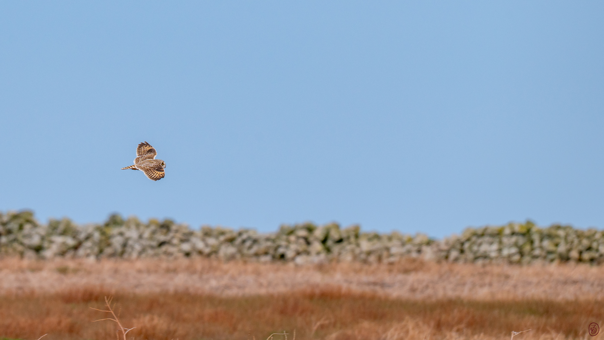
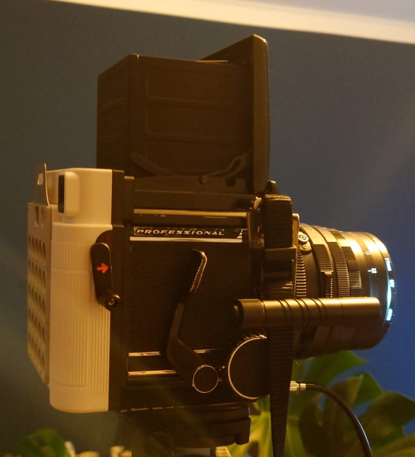
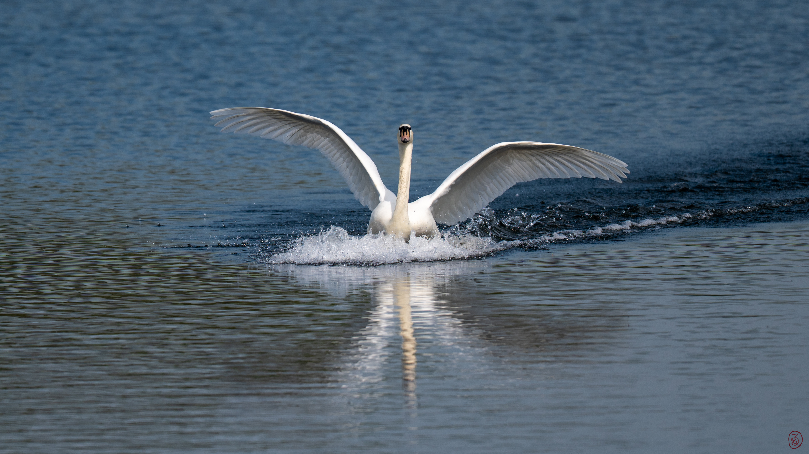

## Formatierung im Vergleich

Dies ist **Testbeitrag 11**. Hier stehen **fette Wörter**, *kursive Hinweise* und ein [Beispiellink](https://example.com) in einem Absatz.

### Ein Bild im Artikel

{width=80% round=12px align=center}

#### Abschluss des Format-Checks

Dieser Absatz steht unter einer kleineren Überschrift. Damit lassen sich Text, Link und Bild innerhalb desselben Beitrags vergleichen.

### Kleines Bild mit runden Ecken

Ein zweites Motiv testet eine schmalere Bildbreite.

{width=50% round=24px align=center}

### Bild ohne zusätzliche Einstellungen

Die einfache Markdown-Syntax aus der README funktioniert ohne Größenangaben.

