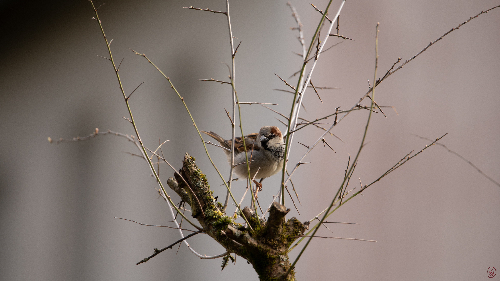

## Zeit für eine Pause

Dies ist **Testbeitrag 03**. Der Duft von frisch gemahlenem Kaffee kündigt eine kleine Auszeit an.

{width=80% round=12px align=center}

### Unser Testrezept

Frisch mahlen, heißes Wasser aufgießen und kurz ziehen lassen.

**Notiz:** Dieser Text ist ein Beispielinhalt für die Darstellung kurzer Absätze.
