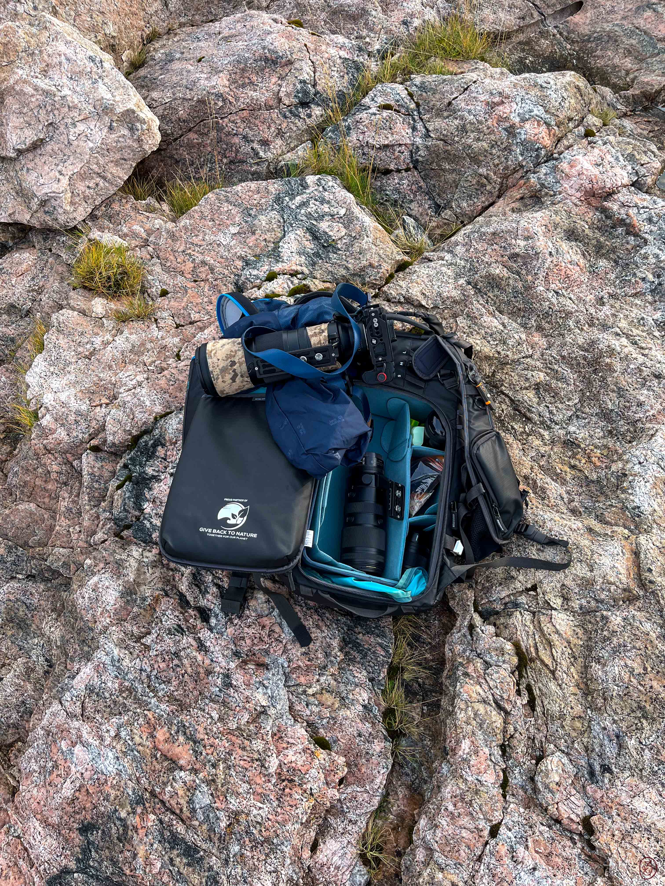

## Unterwegs zum Gipfel

Dies ist **Testbeitrag 02**. Noch vor Sonnenaufgang startet unsere erfundene Tour in die Berge.

{width=80% round=12px align=center}

### Im Rucksack

Wasser, eine Jacke und eine Karte begleiten uns nach oben.

### Die Aussicht

Am Gipfel reicht ein Moment der Ruhe, um den Aufstieg zu genießen.
