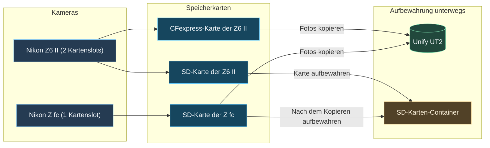
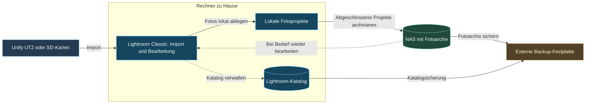

## Warum ich meine Fotos unterwegs sichere

## Meine Ausrüstung

## Mein Ablauf nach einem Fototag

### Reise-Backup im Überblick

Das Diagramm übernimmt die Geräte und Kopierwege der bisherigen Skizze. Unify UT2 und SD-Karten-Container werden getrennt aufbewahrt. Bevor eine Karte erneut verwendet oder geleert wird, muss die Übertragung geprüft sein.

### Fotos übertragen

### Sicherung überprüfen

### Kopien getrennt aufbewahren

## Zurück zu Hause

Diese Übersicht zeigt den Übergang von unterwegs zur Ablage zu Hause. Fotos und Lightroom-Katalog bleiben getrennte Bestandteile der Sicherung. Die ausführliche Speicherstruktur steht im Beitrag [Datenspeicherung, Organisation und Backups](https://zarakuro.de/?slug=datenspeicherung-organisation-und-backups#article).

## Was sich für mich bewährt hat

