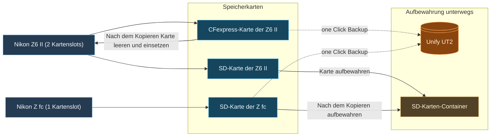

### Meine Ausrüstung
Auf längeren Reisen ( in der Regel alles mehr als eine Woche) nehme ich einen UT2 portablen NAS mit. Für mich hat der den Vorteil, dass er auf Akku läuft und SD sowie CFE Karten direkt per one click backup ohne bildschirm kopieren kann. 

### Mein Ablauf nach einem Fototag
Zuerst landen alle Daten von den SD-Karten auf dem NAS. Bei der Z6 II (zwei Kartenslots) wird danach die CFexpress-Karte geleert, die SD-Karte wandert in einen separaten Container. Vor allem, weil ich nur dre CFE Karten habe und mehr SD Karten. Bei der Z fc wandert die SD-Karte nach dem Sichern ebenfalls in den Container. Der Container und der NAS werden getrennt voneinander aufbewahrt, teilweise sogar in unterschiedlichen Koffern. So habe ich immer ein zweites Backup getrennt vom eigentlichen Kamerarucksack.

Das Diagramm übernimmt die Geräte und Kopierwege der bisherigen Skizze. Unify UT2 und SD-Karten-Container werden getrennt aufbewahrt. Bevor eine Karte erneut verwendet oder geleert wird, muss die Übertragung geprüft sein.

Zurück zu Hause werden die SD Karten und der UT2 in lightroom importiert. 
Diese Übersicht zeigt den Übergang von unterwegs zur Ablage zu Hause. Fotos und Lightroom-Katalog bleiben getrennte Bestandteile der Sicherung. Die ausführliche Speicherstruktur steht im Beitrag [Datenspeicherung, Organisation und Backups](https://zarakuro.de/?slug=datenspeicherung-organisation-und-backups#article).

