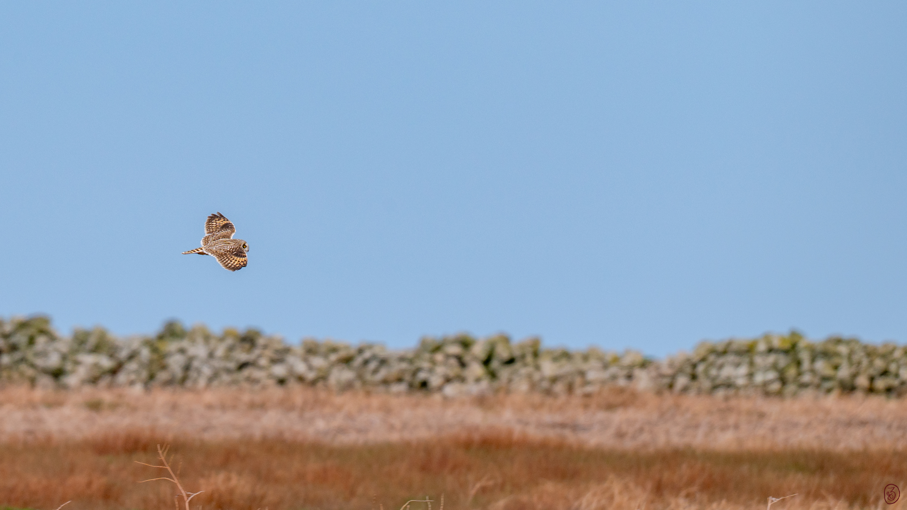
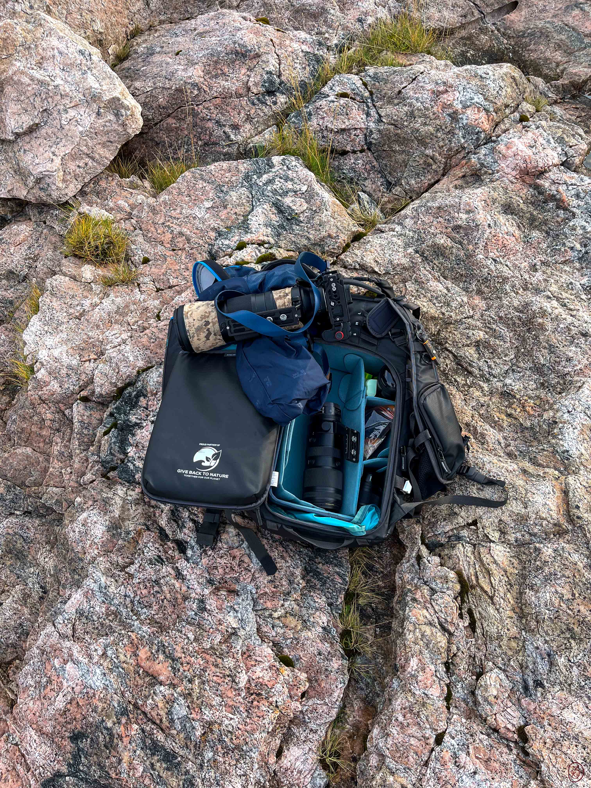

## Wofür diese Anleitung gedacht ist

Hier sammle ich die Schreibweisen und Abläufe, die ich für diesen Blog verwende. Die Anleitung ist zugleich eine Referenz für alle, die ein ähnliches Blog auf Carrd betreiben: Du findest zu den wichtigsten Funktionen die Syntax zum Kopieren und, wo hilfreich, ein sichtbares Beispiel.

Die Angaben beziehen sich auf den Blog-Embed `pk-blog-embed` in Version 1.0.1 zusammen mit meinem Zusatz `carrd-cover-fix.html`. Einige Schreibweisen sind Carrd-Erweiterungen. Sie funktionieren deshalb nicht automatisch in jedem Markdown-Editor. Für die endgültige Darstellung zählt die veröffentlichte Blogseite.

## Vom Entwurf zum Artikel

### Einen Entwurf anlegen

Lege eine Markdown-Datei im Ordner `drafts/` an, beispielsweise `meine-fototour.md`. Dort kannst du den Beitrag vorbereiten, ohne dass er in der Blogübersicht erscheint. Der Blog liest die veröffentlichten Artikel aus `posts/`.

Ein Dateiname mit Kleinbuchstaben und Bindestrichen ist leicht zu handhaben. Die Endung `.md` ist erforderlich.

### Die Grundvorlage

Kopiere diese Vorlage und ersetze die Angaben durch deine eigenen:

```yaml
---
title: "Meine Fototour"
slug: "meine-fototour"
date: "2026-11-06"
published_date: "2026-11-06"
excerpt: "Eine kurze Vorschau auf den Inhalt des Artikels."
author: "Zarakuro"
author_url: "https://zarakuro.de/"
icon: "https://cdn.jsdelivr.net/gh/twitter/twemoji@14.0.2/assets/72x72/1f4f7.png"
---

## Unterwegs mit der Kamera

Hier beginnt mein Artikel.
```

Der Block zwischen den ersten beiden Zeilen mit `---` enthält die Metadaten. Der eigentliche Artikel beginnt danach. Jeder Schlüssel darf im Metadatenblock nur einmal vorkommen.

| Feld | Bedeutung |
| :--- | :--- |
| `title` | Sichtbarer Titel des Artikels. |
| `slug` | Eindeutiger Bestandteil der Artikeladresse. Jeder Beitrag braucht einen eigenen Slug. |
| `date` | Datum des aktuellen Inhaltsstands; danach wird die Übersicht sortiert. |
| `published_date` | Ursprüngliches Veröffentlichungsdatum für die Datumsanzeige im Artikel. |
| `cover` | Optionale direkte Bildadresse für die Galerieübersicht. |
| `excerpt` | Kurzer Vorschautext. Ohne dieses Feld wird eine Vorschau aus dem Artikeltext erzeugt. |
| `author` | Angezeigter Autorenname. Hier verwende ich Zarakuro. |
| `author_url` | Link hinter dem Autorennamen. |
| `icon` | Direkte Bildadresse für das kleine Icon neben dem Autor. |

`title`, `slug` und `date` sind Pflichtfelder des Blog-Embeds. `published_date` ergänzt die Anzeige über meinen Zusatz. Ohne diesen Eintrag bleibt die bisherige Datumsanzeige erhalten.

Für Textwerte und Datumsangaben verwende ich Anführungszeichen. Mit `null` lassen sich Autor, Autorenlink oder Icon ausdrücklich ausblenden. Fehlt eines dieser Autorenfelder ganz, verwendet der Embed die entsprechende Angabe aus dem GitHub-Profil.

### Veröffentlichen

Wenn der Beitrag fertig ist, entferne die Entwurfsnotizen und setze beide Datumsfelder auf das Veröffentlichungsdatum. Verschiebe die Datei anschließend von `drafts/` nach `posts/`, committe und pushe die Änderung zu GitHub.

Die GitHub Action erzeugt danach automatisch die Datei `posts.json`. Diese Datei wird nicht von Hand bearbeitet. Warte auf den Abschluss der Action und prüfe den Artikel auf der Website. Den automatischen GitHub-Commit kannst du anschließend mit `git pull` lokal übernehmen.

Ein zukünftiges Datum plant keine Veröffentlichung. Eine Datei unter `posts/` ist nach der Verarbeitung sichtbar, auch wenn ihr Datum in der Zukunft liegt.

### Einen Artikel später aktualisieren

Bei einer Überarbeitung bleibt `published_date` bestehen. Nur `date` bekommt das neue Datum:

```yaml
published_date: "2026-11-06"
date: "2027-02-15"
```

Im Artikel steht dann „Veröffentlicht am 06.11.2026 · Aktualisiert am 15.02.2027“. Sind beide Angaben gleich, erscheint nur das Veröffentlichungsdatum. Die Galerie behält ihre normale Datumsanzeige und sortiert nach `date`, sodass überarbeitete Beiträge wieder nach oben rücken.

Bei bestehenden Artikeln zuerst das ursprüngliche Veröffentlichungsdatum festhalten, bevor du `date` änderst. Der Zusatz rekonstruiert es nicht automatisch aus der Git-Historie.

---

## Überschriften und Fließtext

Der Artikel hat bereits einen Titel. Für seine Abschnitte verwende ich überwiegend Überschriften ab Ebene zwei:

```markdown
# Große Überschrift
## Abschnitt
### Unterabschnitt
#### Kleiner Unterabschnitt
```

Die Ebenen eins bis vier haben im Embed eigene Schriftgrößen. Fünf und sechs werden erkannt, besitzen dort aber keine eigene Größendefinition. Für eine verlässliche Gliederung bleibe ich deshalb bei den ersten vier Ebenen.

Ein einfacher Zeilenumbruch wird im Blog als Umbruch dargestellt. Eine Leerzeile trennt Textabschnitte optisch. Die Carrd-Schreibweise `\n` erzeugt ebenfalls einen Zeilenumbruch; `\s` fügt einen geschützten Abstand ein.

## Text hervorheben

| Wirkung | Schreibweise | Ergebnis |
| :--- | :--- | :--- |
| Fett | `**wichtig**` | **wichtig** |
| Kursiv | `*betont*` | *betont* |
| Unterstrichen | `__Hinweis__` | __Hinweis__ |
| Durchgestrichen | `~~veraltet~~` | ~~veraltet~~ |
| Markiert | `==merken==` | ==merken== |
| Tiefgestellt | `H~2~O` | H~2~O |
| Hochgestellt | `m^2^` | m^2^ |

Einzelne Befehle oder Feldnamen lassen sich mit Backticks als Inline-Code schreiben, beispielsweise `published_date`. Kursiv funktioniert auch mit einzelnen Unterstrichen. Doppelte Unterstriche bedeuten in diesem Renderer Unterstreichung; GitHub zeigt dieselbe Schreibweise als Fettdruck.

Für Kombinationen eignet sich beispielsweise diese Schreibweise:

```markdown
**Fett mit _kursivem Teil_**
```

**Fett mit _kursivem Teil_**

### Textfarben

Farben werden über eine Carrd-Erweiterung angegeben:

```markdown
[Text in Blau]{#66CCFF}
[**Fett und farbig**]{#16465E}
```

[Text in Blau]{#66CCFF}

Die Farbe `#16465E` verwende ich für Gestaltungselemente. Auf einem dunklen Hintergrund eignet sich ein hellerer Ton wie `#66CCFF` besser für gut lesbaren Text. Auch Farbnamen wie `orange` werden erkannt.

## Links setzen

Ein Link besteht aus einer Beschriftung in eckigen Klammern und dem Ziel in runden Klammern:

```markdown
[Zarakuro besuchen](https://zarakuro.de/)
[Zur Blogübersicht](#blog)
```

[Zarakuro besuchen](https://zarakuro.de/)

Externe Weblinks öffnen sich in einem neuen Tab. Ein Abschnittslink wie `#blog` benötigt einen Abschnitt mit dieser Kennung auf der Carrd-Seite. Eine alleinstehende URL wird nicht automatisch zum Link; verwende deshalb immer eine Beschriftung und ein Linkziel.

Für Kontaktlinks unterstützt der Renderer außerdem `mailto:`, `tel:` und `skype:`. Hinter dem Doppelpunkt muss das passende Ziel stehen.

## Bilder aus dem Repository einbinden

Lade Bilder in den Ordner `images/` des öffentlichen GitHub-Repositories hoch. Im Beitrag verwendest du die direkte Raw-Adresse, nicht die GitHub-Seite zur Dateiansicht.

Dieses Muster musst du für ein eigenes Repository anpassen:

```text
https://raw.githubusercontent.com/BENUTZER/REPOSITORY/main/images/bild.jpg
```

Für diesen Blog lautet ein vollständiges Beispiel:

```markdown
{width=80% round=12px align=center}
```

*Formatbeispiel: Die folgenden Aufnahmewerte sind frei gewählt, da diese Bilddatei keine entsprechenden EXIF-Daten enthält.*

{width=80% round=12px align=center}

**Brennweite:** 600 mm · **Belichtungszeit:** 1/2000 s · **ISO:** 800
**Kamera:** Nikon Z6 II · **Objektiv:** NIKKOR Z 180–600 mm f/5,6–6,3 VR
**Beispielstandort:** [52.516275, 13.377704 – in OpenStreetMap öffnen](https://www.openstreetmap.org/?mlat=52.516275&mlon=13.377704#map=16/52.516275/13.377704)

Der verlinkte Beispielstandort ist das Brandenburger Tor in Berlin und bezeichnet nicht den Aufnahmeort dieses Fotos.

Die Beschreibung zwischen den eckigen Klammern ist der Alternativtext. Beschreibe darin kurz das Motiv. Leerzeichen und Klammern im Dateinamen müssen in der Adresse kodiert sein: `%20` für ein Leerzeichen, `%28` und `%29` für Klammern. Einfache Dateinamen wie `vogel-im-flug.jpg` ersparen diese Umwandlung.

### Bildgrößen und Rundungen

Für meine Artikel gelten diese Einstellungen:

| Ausrichtung | Breite | Rundung | Platzierung |
| :--- | ---: | :---: | :--- |
| Querformat | 80 % | 12 px | Zentriert |
| Hochformat | 50 % | 12 px | Zentriert |

Ein Hochkantbild wird entsprechend so eingebunden:

```markdown
{width=50% round=12px align=center}
```

{width=50% round=12px align=center}

**Brennweite:** 5,1 mm · **Belichtungszeit:** 1/730 s · **ISO:** 50
**Kamera:** Apple iPhone 13 mini · **Objektiv:** iPhone 13 mini back dual wide camera 5.1mm f/1.6

Diese Angaben stammen aus den EXIF-Daten der Bilddatei. Die Brennweite ist der tatsächliche Wert und kein auf Kleinbild umgerechneter Wert. Da keine GPS-Daten hinterlegt sind, bleibt der Standort hier weg.

Breite, Rundung und Ausrichtung werden direkt nach der Bildklammer in geschweiften Klammern angegeben. Die Werte sind optional und werden pro Bild eingetragen; die Ausrichtung des Fotos wird dabei nicht automatisch erkannt.

Für die Breite sind Prozent, Pixel, `em` und `rem` möglich. Bei der Ausrichtung stehen `left`, `center` und `right` zur Wahl. `round=0px` lässt die Ecken gerade, `round=50%` erzeugt bei einem quadratischen Motiv eine kreisförmige Darstellung. Das Seitenverhältnis bleibt erhalten. Ohne Optionen ist das Bild höchstens so breit wie der verfügbare Bereich.

PNG-Dateien und Diagramme funktionieren mit derselben Syntax wie JPG-Dateien.

### Fotos groß ansehen

Ein Klick auf ein Artikelbild öffnet die Fotoansicht. Zunächst wird das vollständige Bild passend zum Bildschirm angezeigt. Ein weiterer Klick auf das Foto wechselt zur Originalgröße; über die Scrollleisten kannst du dann den gewünschten Ausschnitt ansehen. Noch einmal klicken passt das Bild wieder in die Ansicht ein.

Mit Escape, „Schließen“ oder einem Klick auf den freien Hintergrund der Fotoansicht kehrst du zum Artikel zurück. Per Tastatur kannst du ein Artikelbild mit Tab auswählen und mit Enter oder Leertaste öffnen.

Für diese Funktion ist keine zusätzliche Bildsyntax nötig. Die Fotoansicht lädt dieselbe Bilddatei wie der Artikel. Eine hochauflösende Datei bietet deshalb mehr Details beim Vergrößern; eine kleine Datei erhält dadurch keine zusätzlichen Bildinformationen. Der Rechtsklick- und Ziehschutz gilt auch für das Bild in der Fotoansicht.

### Aufnahmeinformationen unter einem Foto

Aufnahmeinformationen stehen direkt unter dem Bild im Artikeltext. Sie sind unabhängig vom Metadatenblock am Anfang des Beitrags und können für jedes Foto unterschiedlich sein. Der Blog liest diese Angaben nicht automatisch aus dem Bild aus.

Die feste Reihenfolge lautet **Brennweite → Belichtungszeit → ISO → Kamera → Objektiv → optional Standort**. Die ersten drei Werte stehen in einer Zeile, Kamera und Objektiv in der nächsten. Der aktuelle Carrd-Zusatz ordnet diese Angaben dem vorangehenden Foto als dezente Bildunterschrift zu: kleiner, farblich zurückgenommen und auf die Breite des Bildes begrenzt.

Beginne die Beschriftung mit `**Brennweite:**` und setze sie direkt unter das Bild. Eine Leerzeile zwischen Bild und Daten ist erlaubt; anderer Fließtext gehört davor oder danach. Kamera und optional Standort folgen ohne Leerzeile innerhalb des Datenblocks. Nach der letzten Datenzeile trennt eine Leerzeile die Beschriftung vom weiteren Artikeltext. Die folgende Vorlage wird also erst dann zur Bildunterschrift, wenn sie unter einem eingebundenen Foto steht.

```markdown
**Brennweite:** 85 mm · **Belichtungszeit:** 1/250 s · **ISO:** 200
**Kamera:** Kameramodell · **Objektiv:** Objektivbezeichnung
```

Schreibe die Brennweite in `mm`, die Belichtungszeit als Bruch oder Sekundenwert wie `1/250 s` beziehungsweise `30 s` und ISO als Zahl. Verwende bei der Brennweite den tatsächlichen Aufnahme-Wert; falls du stattdessen ein Kleinbildäquivalent angibst, kennzeichne es ausdrücklich mit `mm (KB)`.

Fehlen Angaben, schreibe beispielsweise `nicht hinterlegt`, statt Werte zu schätzen. Die Objektivbezeichnung kann die maximale Blende enthalten; eine eigene Angabe der tatsächlich verwendeten Aufnahmeblende ist in dieser ersten Vorlage noch nicht vorgesehen.

### Koordinaten mit OpenStreetMap verlinken

Wenn du einen Aufnahmeort angeben möchtest, ergänze eine dritte Zeile. Dieses vollständige Muster verwendet wieder einen ausdrücklich gewählten Beispielstandort:

```markdown
**Standort:** [52.516275, 13.377704 – in OpenStreetMap öffnen](https://www.openstreetmap.org/?mlat=52.516275&mlon=13.377704#map=16/52.516275/13.377704)
```

Die Reihenfolge ist immer **Breitengrad, Längengrad**. Verwende in der URL Dezimalpunkte. `mlat` und `mlon` setzen den Marker; hinter `#map=` stehen Zoomstufe, Breitengrad und Längengrad. Im Beispiel ist die Zoomstufe `16`. Ersetze beide Koordinatenpaare im Link durch dieselben tatsächlichen Werte. Ohne Standortangabe lässt du die gesamte Zeile weg.

Als Orientierung für kompakte Aufnahmedaten dienen beispielsweise die [Fotobeschreibungen auf Flickr](https://www.flickr.com/photos/tags/iso1000/). Die hier festgelegte Reihenfolge ist meine eigene Konvention. Der Aufbau des Kartenlinks folgt der [OpenStreetMap-Dokumentation zu Markern und Kartenadressen](https://wiki.openstreetmap.org/wiki/Browsing#Other_URL_tricks).

### Ein Cover ergänzen

Das Cover wird getrennt vom Artikelbild im Metadatenblock angegeben:

```yaml
cover: "https://raw.githubusercontent.com/Zarakuro/MyBlog/main/images/WallpaperDownload%20%2812%29.jpg"
```

Es erscheint in der Galerieübersicht. Soll dasselbe Motiv auch im Artikel stehen, füge es zusätzlich mit der Bildsyntax in den Text ein.

## Tabellen schreiben

Eine Tabelle beginnt mit einer Kopfzeile. Darunter steht eine Trennzeile mit mindestens drei Bindestrichen je Spalte, danach folgen die Datenzeilen:

```markdown
| Format | Breite | Rundung |
| :--- | ---: | :---: |
| Querformat | 80 % | 12 px |
| Hochformat | 50 % | 12 px |
```

| Format | Breite | Rundung |
| :--- | ---: | :---: |
| Querformat | 80 % | 12 px |
| Hochformat | 50 % | 12 px |

`:---` richtet eine Spalte links aus, `---:` rechts und `:---:` zentriert. Ohne Doppelpunkt gilt linksbündige Ausrichtung. Auf schmalen Bildschirmen lassen sich breite Tabellen seitlich scrollen.

Für einen senkrechten Strich innerhalb einer Zelle schreibe `\|`. Fett, Links und Inline-Code sind auch in Tabellenzellen möglich.

## Zitate hervorheben

Beginne jede Zitatzeile mit `>`. Ein leerer Absatz innerhalb des Zitats bekommt ebenfalls dieses Zeichen:

```markdown
> Ein Bild kann eine Geschichte erzählen.
>
> Manchmal braucht es dafür nur einen ruhigen Moment.
```

> Ein Bild kann eine Geschichte erzählen.
>
> Manchmal braucht es dafür nur einen ruhigen Moment.

## Code und Syntaxbeispiele zeigen

Mehrzeiliger Code wird zwischen drei Backticks eingeschlossen. Nach dem öffnenden Trenner kannst du einen Sprachnamen angeben. Die folgende Darstellung zeigt die vollständige Schreibweise:

~~~markdown
```yaml
author: "Zarakuro"
export:
  format: "jpg"
  quality: 90
```
~~~

So erscheint der Inhalt:

```yaml
author: "Zarakuro"
export:
  format: "jpg"
  quality: 90
```

Einrückungen, Zeilenumbrüche und Sonderzeichen bleiben im Codeblock erhalten. Markdown innerhalb des Blocks wird nicht formatiert und HTML nicht ausgeführt. Der Sprachname dient als Beschriftung; eine farbige Syntaxhervorhebung gibt es nicht. Breite Codezeilen lassen sich seitlich scrollen.

Drei Tilden funktionieren ebenfalls als Trenner. Das ist hilfreich, wenn du wie oben die Backticks selbst erklären möchtest.

## Aufgabenlisten verwenden

Mit `- [ ]` markierst du offene und mit `- [x]` erledigte Aufgaben:

```markdown
- [x] Text fertiggestellt
- [ ] Bilder und Links prüfen
- [ ] Beitrag veröffentlichen
```

- [x] Text fertiggestellt
- [ ] Bilder und Links prüfen
- [ ] Beitrag veröffentlichen

Die Kästchen zeigen den Zustand aus der Markdown-Datei. Sie lassen sich im veröffentlichten Artikel nicht ändern. Zum Abhaken bearbeitest du die Datei.

Normale Aufzählungen mit Bindestrichen und nummerierte Listen werden derzeit nicht als eigene Listenelemente umgesetzt. Verwende für strukturierte Vergleiche eine Tabelle oder gliedere den Inhalt mit Zwischenüberschriften.

## Abschnitte mit einer Linie trennen

Schreibe drei Bindestriche in eine eigene Zeile und lasse davor und danach eine Leerzeile:

```markdown
Text vor der Linie.

---

Text nach der Linie.
```

---

Alternativ funktionieren `***` und `___`. Ein Backslash vor der Linie ist nicht nötig. Im Codeblock bleiben die Zeichen als Quelltext sichtbar.

## Fußnoten ergänzen

Fußnoten eignen sich für Quellen, Erläuterungen oder Nebenbemerkungen, die den Lesefluss nicht unterbrechen sollen. Setze einen Verweis in den Text und definiere die Erklärung an einer eigenen Stelle:

```markdown
Die Erklärung steht in einer Fußnote[^hinweis].

[^hinweis]: Hier steht die zusätzliche Information.
```

Die Erklärung steht in einer Fußnote[^hinweis]. Auch mehrere Verweise auf dieselbe Erklärung sind möglich[^hinweis]. Eine weitere Fußnote kann einen Link enthalten[^quelle].

Die Erklärungen werden am Artikelende gesammelt und nach ihrem ersten Verweis nummeriert. Rücksprunglinks führen zur jeweiligen Textstelle zurück. Für eine fortgesetzte Erklärung rückst du die nächste Zeile mit vier Leerzeichen ein. Fußnoten in Codebeispielen bleiben als Quelltext stehen.

[^hinweis]: Diese Fußnote gehört zum sichtbaren Beispiel. **Textauszeichnungen** sind auch in der Erklärung möglich.
[^quelle]: Eine Erklärung mit [Beispielquelle](https://example.com).

## Spoiler aufklappen

Umschließe einen Text mit je zwei senkrechten Strichen:

```markdown
||Diese Zusatzinformation wird erst beim Aufklappen sichtbar.||
```

||Diese Zusatzinformation wird erst beim Aufklappen sichtbar.||

Der Zusatz macht daraus eine Schaltfläche mit „Spoiler anzeigen“ und „Spoiler verbergen“. Sie lässt sich per Klick, Enter oder Leertaste bedienen. Verwende hier die Schreibweise mit den Strichen; `spoiler:`-Links werden von dieser Embed-Version nicht umgesetzt.

## Texte per Klick kopieren

Ein Kopierlink enthält die Beschriftung und direkt nach `copy:` den zu kopierenden Text:

```markdown
[Text kopieren](copy:Foto-Workflow)
[Alternativen Text kopieren](clipboard:Meine Packliste)
```

[Text kopieren](copy:Foto-Workflow)

[Alternativen Text kopieren](clipboard:Meine Packliste)

Beide Varianten kopieren den angegebenen Inhalt. Eine kurze Meldung bestätigt den Vorgang. Blockiert der Browser den Zugriff, wird das ebenfalls angezeigt. Die Links lassen sich auch per Enter oder Leertaste auslösen.

Für längere oder komplexe Codebeispiele verwende ich einen Codeblock, dessen Inhalt sich manuell markieren und kopieren lässt.

## Icons nach Artikelart auswählen

Das kleine Icon neben dem Autor dient hier zugleich als Orientierung zum Thema:

| Icon | Verwendung |
| :--- | :--- |
| 📷 | Fotografie und Fotoausrüstung |
| 🎞️ | Allgemeines |
| 💻 | Computer, Fotosortierung und Bildbearbeitung |
| 📝 | Notizen, Spaziergänge und Alltagsberichte |

Im Fließtext können Emojis direkt geschrieben werden. Im Metadatenfeld `icon` verwende ich eine Bildadresse, weil der externe Embed ein Emoji-Zeichen dort fälschlich als Bildadresse behandelt. Für das Foto-Icon lautet die Zeile:

```yaml
icon: "https://cdn.jsdelivr.net/gh/twitter/twemoji@14.0.2/assets/72x72/1f4f7.png"
```

Weitere Adressen stehen in der Datei `EMOJI-UEBERSICHT.md` im Repository. Auch eigene Bilder sind als Icon möglich; angezeigt werden sie klein und rund zugeschnitten.

## Weitere Carrd-Aktionen

Neben normalen Links erkennt der Renderer spezielle Aktionsziele. Sie setzen teilweise passende Carrd-Funktionen, Abschnitte oder Scrollpunkte voraus:

| Ziel im Link | Aktion |
| :--- | :--- |
| `browser:back` und `browser:forward` | Im Browserverlauf zurück oder vorwärts gehen. |
| `browser:top` | An den Seitenanfang scrollen. |
| `browser:print` | Den Druckdialog öffnen. |
| `section:next` und `section:previous` | Zum nächsten oder vorherigen Abschnitt wechseln. |
| `section:first` und `section:last` | Zum ersten oder letzten Abschnitt wechseln. |
| `scrollpoint:next` und `scrollpoint:previous` | Zum nächsten oder vorherigen Scrollpunkt wechseln. |
| `scrollpoint:first` und `scrollpoint:last` | Zum ersten oder letzten Scrollpunkt wechseln. |

Ein Beispiel für die Syntax:

```markdown
[Druckansicht öffnen](browser:print)
```

Zurück und Vorwärts hängen vom vorhandenen Browserverlauf ab. Prüfe solche Aktionslinks auf deiner eigenen Seite, bevor du sie in einem Artikel verwendest.

## Darstellung prüfen und typische Fehler finden

### Tabellen oder andere Formate bleiben als Zeichen sichtbar

Tabellen, Codeblöcke, Zitate, Aufgabenlisten, Trennlinien, Fußnoten, Spoiler und Kopierlinks benötigen den aktuellen Carrd-Zusatz. Übernimm dafür den vollständigen Inhalt von `carrd-cover-fix.html` als Embed unter **Code / Hidden / Body End** nach dem Blog-Embed und veröffentliche die Carrd-Seite erneut.

Ersetze den bisherigen Zusatz vollständig. Die HTML-Datei enthält einen kleinen Loader für `blog-enhancements.js`. Diese JavaScript-Datei muss zuerst im Hauptverzeichnis des öffentlichen GitHub-Repositories liegen. Für ein anderes Repository muss die Ladeadresse in der HTML-Datei angepasst werden. Weitere Änderungen an der JavaScript-Datei werden über GitHub veröffentlicht.

Carrd begrenzt den Code pro Embed auf 16.384 Zeichen; der Loader bleibt deutlich darunter. Am Dateiende muss `</script>` stehen. Der externe Blog-Embed bleibt zusätzlich eingebunden.

### Ein Bild fehlt

Prüfe die direkte Bildadresse und die Schreibweise des Dateinamens einschließlich Groß- und Kleinschreibung. Das Bild muss öffentlich erreichbar und bereits zu GitHub hochgeladen sein. Ein Pfad, der nur auf dem eigenen Computer existiert, funktioniert für Besucher nicht.

### Das Cover ist nur als farbige Fläche sichtbar

Der Zusatz korrigiert Carrds verzögertes Laden bei den vom Blog erzeugten Galeriekarten. Prüfe deshalb sowohl die Bildadresse als auch die Einbindung des aktuellen Zusatzes.

### HTML-Tags erscheinen im Text

HTML wird als Quelltext ausgegeben. Verwende die hier beschriebenen Markdown-Formate, beispielsweise `**fett**` statt eines HTML-Tags. Auch Fußnoten, Tabellen und Bilder lassen sich damit ohne eigenes HTML schreiben.

### Die GitHub-Vorschau sieht anders aus

GitHub verwendet einen anderen Markdown-Renderer. Insbesondere Unterstreichung, Farben, Bildoptionen und Carrd-Aktionen können dort anders aussehen oder als Text stehen bleiben. Kontrolliere den fertigen Artikel auf der veröffentlichten Seite, auch auf einem schmalen Bildschirm.

### Bilder lassen sich nicht per Rechtsklick speichern

Der Zusatz blockiert Rechtsklick und Ziehen auf Artikelbildern und zeigt den Hinweis auf den Downloadbereich. Das erschwert das direkte Speichern, ist aber kein vollständiger Kopierschutz. Für andere Websites muss dieser Hinweis zum eigenen Downloadangebot passen.

## Vor dem Veröffentlichen

- [ ] Titel, Vorschautext und eindeutigen Slug prüfen.
- [ ] Veröffentlichungsdatum und aktuellen Inhaltsstand kontrollieren.
- [ ] Autor, Autorenlink und Icon passend eintragen.
- [ ] Öffentliche Bildadressen, Alternativtexte und Bildbreiten prüfen.
- [ ] Quellen und erforderliche Bildnachweise ergänzen.
- [ ] Entwurfsnotizen entfernen und Datei nach `posts/` verschieben.
- [ ] Änderungen committen und pushen; die GitHub Action abwarten.
- [ ] Artikel auf der Website am Desktop und auf dem Smartphone durchsehen.

Die Adresse dieses Leitfadens bleibt trotz des neuen Titels unverändert, damit bereits gesetzte Links weiterhin funktionieren.
